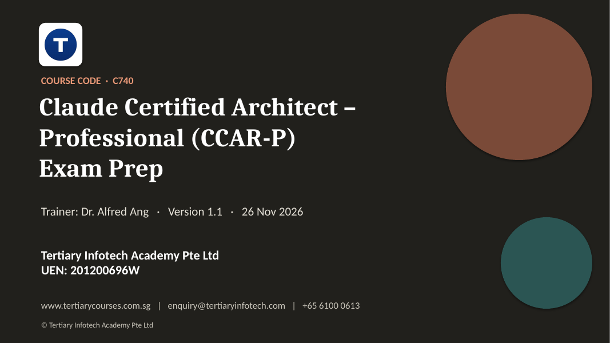

# Claude Certified Architect - Professional (CCAR-P) Exam Prep

Prepare for Anthropic's CCAR-P exam task statement by task statement: answer each of the 38 as an exam-style question, then watch Claude run the scenario live.

| Course detail | Information |
|---|---|
| Course code | `C740` |
| Programme | Non-WSQ |
| Duration | 2 days / 15 hours (9:30am – 5:30pm daily) |
| Courseware release | Trainer slides v1.1, Lesson Plan v1.1, Learner Guide v1.1 (26 Nov 2026) |
| Official exam guide | [Anthropic's CCAR-P Exam Guide v1.0 (PDF, 11 pages)](exam-guide/Claude-Certified-Architect-Professional-CCAR-P-Exam-Guide-v1.0.pdf) |
| Exam-question labs | [Run all 38 labs live in your browser](https://tertiarycourses.github.io/C740-Claude-Certified-Architect-Professional-CCAR-P-Exam-Prep/) |
| Practice exam | [Practice questions, scored by domain](https://exams.tertiaryinfotech.com/practice-exams/anthropic/anthropic-ccar-professional) |
| Registration | [View course details and register](https://www.tertiarycourses.com.sg/claude-certified-architect-professional-ccar-p-exam-prep.html) |

## The exam at a glance

| | |
|---|---|
| Exam code | CCAR-P |
| Questions and time | 63 questions in 120 minutes |
| Format | Multiple-choice and multiple-response questions; each question states how many answers to select |
| Delivery and fee | Proctored, online or at a Pearson VUE test centre; $175 USD per attempt |
| Domains | Seven, weighted 17%, 13%, 19%, 16%, 14%, 14% and 7% |
| Pass mark | 720 on a scale of 100 to 1,000, against a fixed standard; the score report also shows percent-correct by domain |
| Retakes | Wait 14 days after a first fail, 30 after a second and 90 after a third; at most four attempts in a rolling 12 months, each at the full fee |
| Validity | 12 months; renewing on time is free, through a non-proctored assessment |

These figures are from Anthropic's **[Exam Guide v1.0](exam-guide/Claude-Certified-Architect-Professional-CCAR-P-Exam-Guide-v1.0.pdf)** (effective July 2026), which is in this repository. Read it first: it sets out the intended candidate, the seven domains and their weights, the task statements under each domain, three sample questions with explanations, and the exam policies. The guide can change without notice, so check Anthropic's current version before you book.

The exam is written for architects with production experience. Most questions describe a system that is failing, or a sponsor asking for the wrong thing, and offer several fixes that all sound reasonable. The best answer is usually the simplest design that meets the requirement and can be measured: a rule enforced in code where a stronger prompt is on offer, an evaluation where an opinion is on offer.

## How the course prepares you

1. **Day 1 and the morning of Day 2: all 38 task statements, as exam questions.** Each lab on the [lab site](https://tertiarycourses.github.io/C740-Claude-Certified-Architect-Professional-CCAR-P-Exam-Prep/) opens with a four-option question in the exam's style. You commit to an answer, then run the scenario live on `claude-haiku-5-5`: the trap first, then the fix, with the code, the API requests and the outcome side by side. Nothing to install.
2. **Day 2 afternoon: build what the questions describe.** In Labs 39 to 41 you paste copy-ready prompts into your AI coding tool and build a RAG policy assistant that cites its sources, an evaluation harness with an A/B test, and a governed claims agent with an approval gate and an audit log.
3. **Practice exam.** The course ends with an hour on the [practice exam](https://exams.tertiaryinfotech.com/practice-exams/anthropic/anthropic-ccar-professional) in Practice mode, then a review of your score by domain. Finish the full timed attempt at home before you book the real exam.

## Learning outcomes

By the end of the course you will be able to:

- Translate business problems into end-to-end Claude solutions, choosing workflow, agentic or multi-agent patterns and tying them to measurable business value.
- Select Claude models on cost, latency and quality, and design system prompts, examples, context and caching that keep behaviour reliable and token use low.
- Integrate Claude into enterprise systems with least-privilege tools, sound authentication, the right protocol (MCP, API/CLI, agent-to-agent), RAG and observability.
- Define metrics and mixed-method evaluation sets, run A/B tests, diagnose failures and optimise cost-performance with logging and monitoring.
- Implement guardrails, human-in-the-loop review and controls for regulations such as GDPR, HIPAA and FedRAMP, and address bias, fairness and transparency.
- Run structured discovery, communicate decisions and trade-offs, agree SLAs, document architectures and support every lifecycle phase.
- Configure Claude Code for teams, improve developer workflows and resolve operational issues in Claude-powered systems.

## Exam domains and where each is covered

| Topic | Exam domain | Exam weight | Task statements | Labs |
|---|---|---:|---|---|
| Topic 1 | Solution Design & Architecture | 17% | 1.1–1.6 | 1–6 |
| Topic 2 | Claude Models, Prompting & Context Engineering | 13% | 2.1–2.5 | 7–11 |
| Topic 3 | Integration | 19% | 3.1–3.8 | 12–19 |
| Topic 4 | Evaluation, Testing & Optimization | 16% | 4.1–4.6 | 20–25 |
| Topic 5 | Governance, Safety & Risk Management | 14% | 5.1–5.5 | 26–30 |
| Topic 6 | Stakeholder Communication & Lifecycle Management | 14% | 6.1–6.5 | 31–35 |
| Topic 7 | Developer Productivity & Operational Enablement | 7% | 7.1–7.3 | 36–38 |
| Bonus Topic A | Build and evaluate a RAG policy assistant | | 2.2, 3.5, 3.6, 4.1, 4.2, 4.3 | 39–40 |
| Bonus Topic B | Build a governed claims agent | | 3.1, 4.6, 5.1, 5.3 | 41 |

Topics 1 to 4 run on Day 1 and Topics 5 to 7 on the morning of Day 2. The bonus topics and the practice exam fill the afternoon of Day 2.

## The six simulators

Every exam-question lab runs on one of six simulators on the [lab site](https://tertiarycourses.github.io/C740-Claude-Certified-Architect-Professional-CCAR-P-Exam-Prep/). The companies, people and data are fictional. Claude is real.

1. **Harbour Mutual Claims Desk**: An agent that can pay out claims. Design it so it only pays the right ones.
2. **Northwind Policy Assistant**: Ten thousand pages of policy. Every answer cites the page it came from.
3. **Meridian Clinical Notes**: Summaries that save clinicians time, without leaking a single patient record.
4. **Riverton Resident Services**: A public-sector assistant that treats every resident the same way.
5. **Lumen Retail Engagement**: The architect's job before and after the build: discovery, decisions, handoff.
6. **Kestrel Platform Team**: Forty engineers, one shared Claude Code setup, and production to keep running.

### Exam-question labs: nothing to install

Open the **[lab site](https://tertiarycourses.github.io/C740-Claude-Certified-Architect-Professional-CCAR-P-Exam-Prep/)**, paste your Anthropic API key (it starts with `sk-ant-`) into the sidebar, press **Save**, then **Test**. The key stays in your browser and is sent only to Anthropic. Every lab calls `claude-haiku-5-5`, so a whole lab usually costs under one US cent.

### Day 2 afternoon: vibe-code on your laptop

Prompts write the code; you run it. You need an AI coding tool that can edit files and run commands (Claude Code, Codex, Antigravity, Cursor or similar) and an Anthropic API key. Open the tool in a new, empty folder, open the lab's prompt page ([Lab 39](https://tertiarycourses.github.io/C740-Claude-Certified-Architect-Professional-CCAR-P-Exam-Prep/lab-39.html), [Lab 40](https://tertiarycourses.github.io/C740-Claude-Certified-Architect-Professional-CCAR-P-Exam-Prep/lab-40.html), [Lab 41](https://tertiarycourses.github.io/C740-Claude-Certified-Architect-Professional-CCAR-P-Exam-Prep/lab-41.html)) and paste the prompts one at a time. Labs 39 and 40 share one project folder; Lab 41 starts in a second one. When a prompt creates `.env`, type your key into that file yourself, never into the chat.

## Labs

Every lab has its own folder with a step-by-step `README.md` and `README.pdf`.

### One exam-style question and one live simulation per task statement

**Topic 1: Solution Design & Architecture (17% of the exam)**

| Lab | Task statement | Simulator | What the question turns on |
|---|---|---|---|
| 1 | 1.1 | 5 | [Grace asks for an agent: frame the problem before choosing the build](https://tertiarycourses.github.io/C740-Claude-Certified-Architect-Professional-CCAR-P-Exam-Prep/lab.html?n=1) ([guide](labs/lab-01-grace-asks-for-an-agent-frame-the-problem-before/)) |
| 2 | 1.2 | 1 | [$6,500 paid with no check: close the loop around the decision step](https://tertiarycourses.github.io/C740-Claude-Certified-Architect-Professional-CCAR-P-Exam-Prep/lab.html?n=2) ([guide](labs/lab-02-6-500-paid-with-no-check-close-the-loop-around-t/)) |
| 3 | 1.3 | 1 | [An eight-step claims procedure run as an agent: make it a workflow](https://tertiarycourses.github.io/C740-Claude-Certified-Architect-Professional-CCAR-P-Exam-Prep/lab.html?n=3) ([guide](labs/lab-03-an-eight-step-claims-procedure-run-as-an-agent-m/)) |
| 4 | 1.4 | 1 | [Paid and escalated at once: specialists find, a coordinator decides](https://tertiarycourses.github.io/C740-Claude-Certified-Architect-Professional-CCAR-P-Exam-Prep/lab.html?n=4) ([guide](labs/lab-04-paid-and-escalated-at-once-specialists-find-a-co/)) |
| 5 | 1.5 | 3 | [One prompt for the whole discharge pack runs out: split and reconcile](https://tertiarycourses.github.io/C740-Claude-Certified-Architect-Professional-CCAR-P-Exam-Prep/lab.html?n=5) ([guide](labs/lab-05-one-prompt-for-the-whole-discharge-pack-runs-out/)) |
| 6 | 1.6 | 5 | [A board pitch with no numbers: sell the value pillar and the SLAs](https://tertiarycourses.github.io/C740-Claude-Certified-Architect-Professional-CCAR-P-Exam-Prep/lab.html?n=6) ([guide](labs/lab-06-a-board-pitch-with-no-numbers-sell-the-value-pil/)) |

**Topic 2: Claude Models, Prompting & Context Engineering (13% of the exam)**

| Lab | Task statement | Simulator | What the question turns on |
|---|---|---|---|
| 7 | 2.1 | 4 | [Every question at Opus prices: route by difficulty, grade each route](https://tertiarycourses.github.io/C740-Claude-Certified-Architect-Professional-CCAR-P-Exam-Prep/lab.html?n=7) ([guide](labs/lab-07-every-question-at-opus-prices-route-by-difficult/)) |
| 8 | 2.2 | 4 | [A friendly two-liner tells Farah she qualifies: use a prompt template](https://tertiarycourses.github.io/C740-Claude-Certified-Architect-Professional-CCAR-P-Exam-Prep/lab.html?n=8) ([guide](labs/lab-08-a-friendly-two-liner-tells-farah-she-qualifies-u/)) |
| 9 | 2.3 | 1 | [Zero-shot misroutes 3 of 8 claims: show the edges, reason, then label](https://tertiarycourses.github.io/C740-Claude-Certified-Architect-Professional-CCAR-P-Exam-Prep/lab.html?n=9) ([guide](labs/lab-09-zero-shot-misroutes-3-of-8-claims-show-the-edges/)) |
| 10 | 2.4 | 3 | [17 years of notes for one referral: select sections, cap the letter](https://tertiarycourses.github.io/C740-Claude-Certified-Architect-Professional-CCAR-P-Exam-Prep/lab.html?n=10) ([guide](labs/lab-10-17-years-of-notes-for-one-referral-select-sectio/)) |
| 11 | 2.5 | 2 | [8,075 tokens billed in full every call: put them first and cache them](https://tertiarycourses.github.io/C740-Claude-Certified-Architect-Professional-CCAR-P-Exam-Prep/lab.html?n=11) ([guide](labs/lab-11-8-075-tokens-billed-in-full-every-call-put-them/)) |

**Topic 3: Integration (19% of the exam)**

| Lab | Task statement | Simulator | What the question turns on |
|---|---|---|---|
| 12 | 3.1 | 1 | [Paid out and deleted on a customer's say-so: remove the tools](https://tertiarycourses.github.io/C740-Claude-Certified-Architect-Professional-CCAR-P-Exam-Prep/lab.html?n=12) ([guide](labs/lab-12-paid-out-and-deleted-on-a-customers-say-so-remov/)) |
| 13 | 3.2 | 2 | [A teller learns her branch closes: authorize retrieval as the user](https://tertiarycourses.github.io/C740-Claude-Certified-Architect-Professional-CCAR-P-Exam-Prep/lab.html?n=13) ([guide](labs/lab-13-a-teller-learns-her-branch-closes-authorize-retr/)) |
| 14 | 3.3 | 4 | [Max effort everywhere breaks the 4 s chat budget: route by request](https://tertiarycourses.github.io/C740-Claude-Certified-Architect-Professional-CCAR-P-Exam-Prep/lab.html?n=14) ([guide](labs/lab-14-max-effort-everywhere-breaks-the-4-s-chat-budget/)) |
| 15 | 3.4 | 6 | [Grep blames the prompt; traces show inventory_lookup's p95 spike](https://tertiarycourses.github.io/C740-Claude-Certified-Architect-Professional-CCAR-P-Exam-Prep/lab.html?n=15) ([guide](labs/lab-15-grep-blames-the-prompt-traces-show-inventory-loo/)) |
| 16 | 3.5 | 2 | [Fixed chunks split the 60% exception: chunk on headings, cite](https://tertiarycourses.github.io/C740-Claude-Certified-Architect-Professional-CCAR-P-Exam-Prep/lab.html?n=16) ([guide](labs/lab-16-fixed-chunks-split-the-60-exception-chunk-on-hea/)) |
| 17 | 3.6 | 2 | [One similarity search quotes a dead rate: route tables to a lookup](https://tertiarycourses.github.io/C740-Claude-Certified-Architect-Professional-CCAR-P-Exam-Prep/lab.html?n=17) ([guide](labs/lab-17-one-similarity-search-quotes-a-dead-rate-route-t/)) |
| 18 | 3.7 | 6 | [Two hand-built clients, two answers: put the service behind MCP](https://tertiarycourses.github.io/C740-Claude-Certified-Architect-Professional-CCAR-P-Exam-Prep/lab.html?n=18) ([guide](labs/lab-18-two-hand-built-clients-two-answers-put-the-servi/)) |
| 19 | 3.8 | 6 | [40 tools in every request: load the runbook the incident needs](https://tertiarycourses.github.io/C740-Claude-Certified-Architect-Professional-CCAR-P-Exam-Prep/lab.html?n=19) ([guide](labs/lab-19-40-tools-in-every-request-load-the-runbook-the-i/)) |

**Topic 4: Evaluation, Testing & Optimization (16% of the exam)**

| Lab | Task statement | Simulator | What the question turns on |
|---|---|---|---|
| 20 | 4.1 | 2 | [Thumbs-up says ship, nothing cites a source: gate on a scorecard](https://tertiarycourses.github.io/C740-Claude-Certified-Architect-Professional-CCAR-P-Exam-Prep/lab.html?n=20) ([guide](labs/lab-20-thumbs-up-says-ship-nothing-cites-a-source-gate/)) |
| 21 | 4.2 | 3 | [Typical notes passed by eye: a mixed eval set catches the leak](https://tertiarycourses.github.io/C740-Claude-Certified-Architect-Professional-CCAR-P-Exam-Prep/lab.html?n=21) ([guide](labs/lab-21-typical-notes-passed-by-eye-a-mixed-eval-set-cat/)) |
| 22 | 4.3 | 6 | [v2 won the demo and missed SEV1 pages: A/B it on the same alerts](https://tertiarycourses.github.io/C740-Claude-Certified-Architect-Professional-CCAR-P-Exam-Prep/lab.html?n=22) ([guide](labs/lab-22-v2-won-the-demo-and-missed-sev1-pages-a-b-it-on/)) |
| 23 | 4.4 | 2 | [Confident, cited and stale after a re-index: inspect retrieval first](https://tertiarycourses.github.io/C740-Claude-Certified-Architect-Professional-CCAR-P-Exam-Prep/lab.html?n=23) ([guide](labs/lab-23-confident-cited-and-stale-after-a-re-index-inspe/)) |
| 24 | 4.5 | 1 | [Right answers, 3,000 output tokens each: cache, trim, cap, re-test](https://tertiarycourses.github.io/C740-Claude-Certified-Architect-Professional-CCAR-P-Exam-Prep/lab.html?n=24) ([guide](labs/lab-24-right-answers-3-000-output-tokens-each-cache-tri/)) |
| 25 | 4.6 | 6 | ['Answered in 2.4s' can't say why: log every Claude call as a record](https://tertiarycourses.github.io/C740-Claude-Certified-Architect-Professional-CCAR-P-Exam-Prep/lab.html?n=25) ([guide](labs/lab-25-answered-in-2-4s-cant-say-why-log-every-claude-c/)) |

**Topic 5: Governance, Safety & Risk Management (14% of the exam)**

| Lab | Task statement | Simulator | What the question turns on |
|---|---|---|---|
| 26 | 5.1 | 4 | [Forged certificate approved: gate approve_permit on the registers](https://tertiarycourses.github.io/C740-Claude-Certified-Architect-Professional-CCAR-P-Exam-Prep/lab.html?n=26) ([guide](labs/lab-26-forged-certificate-approved-gate-approve-permit/)) |
| 27 | 5.2 | 1 | [Two calls agreed on the wrong payout: let code compute it](https://tertiarycourses.github.io/C740-Claude-Certified-Architect-Professional-CCAR-P-Exam-Prep/lab.html?n=27) ([guide](labs/lab-27-two-calls-agreed-on-the-wrong-payout-let-code-co/)) |
| 28 | 5.3 | 3 | [54 seconds a draft is a signature: route review by risk](https://tertiarycourses.github.io/C740-Claude-Certified-Architect-Professional-CCAR-P-Exam-Prep/lab.html?n=28) ([guide](labs/lab-28-54-seconds-a-draft-is-a-signature-route-review-b/)) |
| 29 | 5.4 | 3 | [The whole record went to the model and the log: send the minimum](https://tertiarycourses.github.io/C740-Claude-Certified-Architect-Professional-CCAR-P-Exam-Prep/lab.html?n=29) ([guide](labs/lab-29-the-whole-record-went-to-the-model-and-the-log-s/)) |
| 30 | 5.5 | 4 | [Same case, other language, other outcome: test with pairs](https://tertiarycourses.github.io/C740-Claude-Certified-Architect-Professional-CCAR-P-Exam-Prep/lab.html?n=30) ([guide](labs/lab-30-same-case-other-language-other-outcome-test-with/)) |

**Topic 6: Stakeholder Communication & Lifecycle Management (14% of the exam)**

| Lab | Task statement | Simulator | What the question turns on |
|---|---|---|---|
| 31 | 6.1 | 5 | [A design from the COO's one line misses legal: interview every group](https://tertiarycourses.github.io/C740-Claude-Certified-Architect-Professional-CCAR-P-Exam-Prep/lab.html?n=31) ([guide](labs/lab-31-a-design-from-the-coos-one-line-misses-legal-int/)) |
| 32 | 6.2 | 5 | [A memo that sells the pick can't be approved: write the record](https://tertiarycourses.github.io/C740-Claude-Certified-Architect-Professional-CCAR-P-Exam-Prep/lab.html?n=32) ([guide](labs/lab-32-a-memo-that-sells-the-pick-cant-be-approved-writ/)) |
| 33 | 6.3 | 5 | ["99.99% and always correct" breaks on day one: commit to measured SLOs](https://tertiarycourses.github.io/C740-Claude-Certified-Architect-Professional-CCAR-P-Exam-Prep/lab.html?n=33) ([guide](labs/lab-33-99-99-and-always-correct-breaks-on-day-one-commi/)) |
| 34 | 6.4 | 5 | [A summary drops the runbook and owners: hand off an ADR and a guide](https://tertiarycourses.github.io/C740-Claude-Certified-Architect-Professional-CCAR-P-Exam-Prep/lab.html?n=34) ([guide](labs/lab-34-a-summary-drops-the-runbook-and-owners-hand-off/)) |
| 35 | 6.5 | 5 | [Drift found 3 weeks late by a complaint: monitors that re-run evals](https://tertiarycourses.github.io/C740-Claude-Certified-Architect-Professional-CCAR-P-Exam-Prep/lab.html?n=35) ([guide](labs/lab-35-drift-found-3-weeks-late-by-a-complaint-monitors/)) |

**Topic 7: Developer Productivity & Operational Enablement (7% of the exam)**

| Lab | Task statement | Simulator | What the question turns on |
|---|---|---|---|
| 36 | 7.1 | 6 | [The team's rules live on one laptop: commit the Claude Code config](https://tertiarycourses.github.io/C740-Claude-Certified-Architect-Professional-CCAR-P-Exam-Prep/lab.html?n=36) ([guide](labs/lab-36-the-teams-rules-live-on-one-laptop-commit-the-cl/)) |
| 37 | 7.2 | 6 | [A chat review can't block PR 512: run claude -p in CI behind a gate](https://tertiarycourses.github.io/C740-Claude-Certified-Architect-Professional-CCAR-P-Exam-Prep/lab.html?n=37) ([guide](labs/lab-37-a-chat-review-cant-block-pr-512-run-claude-p-in/)) |
| 38 | 7.3 | 6 | [6% of summaries fail: trace stop_reason max_tokens, don't guess](https://tertiarycourses.github.io/C740-Claude-Certified-Architect-Professional-CCAR-P-Exam-Prep/lab.html?n=38) ([guide](labs/lab-38-6-of-summaries-fail-trace-stop-reason-max-tokens/)) |

### Day 2 · Bonus Topic A: build and evaluate a RAG policy assistant

You paste prompts, read the code your AI coding tool writes, and run it. Each lab has a prompt page with a Copy button on every prompt, a `starter/` and a `solution/` folder, and a real run in `sample-output.txt`.

| Lab | Task statements | What you build |
|---|---|---|
| 39 | 3.5, 3.6, 2.2 | [Vibe-code a RAG policy assistant that cites its sources](https://tertiarycourses.github.io/C740-Claude-Certified-Architect-Professional-CCAR-P-Exam-Prep/lab-39.html) ([folder](labs/lab-39-build-a-rag-policy-assistant/)) |
| 40 | 4.1, 4.2, 4.3 | [Vibe-code an evaluation harness and A/B test two configurations](https://tertiarycourses.github.io/C740-Claude-Certified-Architect-Professional-CCAR-P-Exam-Prep/lab-40.html) ([folder](labs/lab-40-evaluate-and-a-b-test-the-assistant/)) |

### Day 2 · Bonus Topic B: build a governed claims agent

| Lab | Task statements | What you build |
|---|---|---|
| 41 | 3.1, 5.1, 5.3, 4.6 | [Vibe-code a governed claims agent: least privilege, approval gate, audit log](https://tertiarycourses.github.io/C740-Claude-Certified-Architect-Professional-CCAR-P-Exam-Prep/lab-41.html) ([folder](labs/lab-41-build-a-governed-claims-agent/)) |

### Practice exam

Sit the [practice exam](https://exams.tertiaryinfotech.com/practice-exams/anthropic/anthropic-ccar-professional) in Practice mode at the end of Day 2, review your score by domain, and go back to the labs for your weakest domain. Sit it again under timed conditions (63 questions, 120 minutes) before you book the real exam.

## In this repository

- [Anthropic's CCAR-P Exam Guide v1.0, PDF](exam-guide/Claude-Certified-Architect-Professional-CCAR-P-Exam-Guide-v1.0.pdf)
- [Trainer slides, PowerPoint](courseware/C740-Claude-Certified-Architect-Professional-CCAR-P-Exam-Prep-Trainer-Slides-v1.1.pptx) and [PDF](courseware/C740-Claude-Certified-Architect-Professional-CCAR-P-Exam-Prep-Trainer-Slides-v1.1.pdf)
- [Lesson Plan, Word](courseware/LP-Claude-Certified-Architect-Professional-CCAR-P-Exam-Prep-v1.1.docx) and [PDF](courseware/LP-Claude-Certified-Architect-Professional-CCAR-P-Exam-Prep-v1.1.pdf)
- [Learner Guide, Word](courseware/LG-Claude-Certified-Architect-Professional-CCAR-P-Exam-Prep-v1.1.docx), [PDF](courseware/LG-Claude-Certified-Architect-Professional-CCAR-P-Exam-Prep-v1.1.pdf) and [Markdown](courseware/LG-Claude-Certified-Architect-Professional-CCAR-P-Exam-Prep-v1.1.md)
- [The labs folder](labs/): 41 lab folders (38 exam-question labs and 3 Day 2 builds)
- [`docs/`](docs/): the source of the [lab site](https://tertiarycourses.github.io/C740-Claude-Certified-Architect-Professional-CCAR-P-Exam-Prep/) (GitHub Pages)

Your API key stays on your machine: the lab site keeps it in your browser only, and the Day 2 labs read it from a `.env` file that is never committed. Internal build sources and superseded versions are not published here.

## Provider

Provided by [Tertiary Infotech Academy Pte Ltd](https://www.tertiarycourses.com.sg/) (UEN 201200696W).

This is independent exam-preparation courseware. The practice questions are written for practice and are not real exam items. Claude and the Claude Certified Architect exam are Anthropic's.
